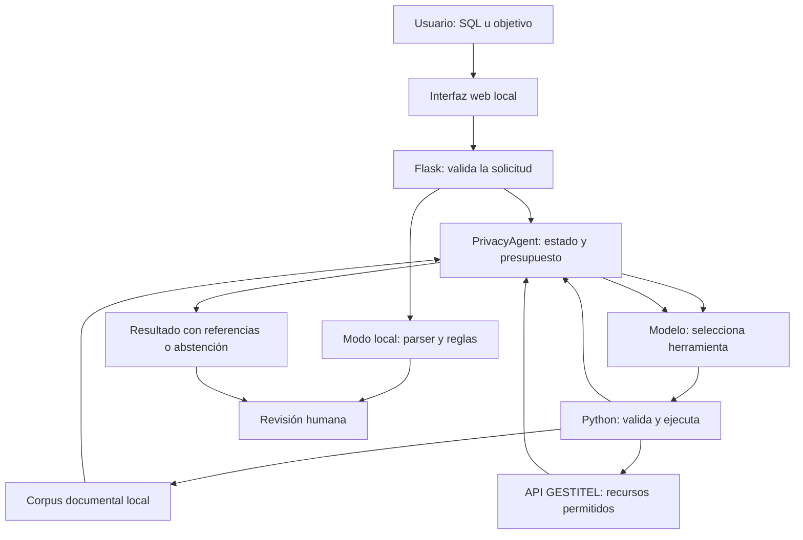

# Guía de uso y exposición: PrivAudit / AgentArch-PIMS con GESTITEL

Versión preparada el 29 de octubre de 2026 a partir del código del proyecto. Esta es la guía principal para demostrar la ampliación con GESTITEL. La guía anterior de EC1 sirve como antecedente. No incluye contraseñas ni claves: usa las credenciales proporcionadas por el profesor y la configuración local existente.

## 1. Qué presentamos y qué problema resuelve

PrivAudit / AgentArch-PIMS es una aplicación académica que ayuda a preparar una revisión de privacidad. Recibe una estructura SQL o un objetivo de consulta, utiliza herramientas acotadas y entrega observaciones respaldadas por evidencia para revisión humana.

Con la ampliación, el agente puede consultar registros actuales de requisitos y controles de GESTITEL. Así se incorporan dos perspectivas: qué datos podría manejar un sistema según su estructura y qué evidencia de gestión está registrada en una plataforma PIMS.

**Frase de apertura sugerida:**

> Nuestro proyecto es un agente de apoyo a la revisión de privacidad. Analiza estructuras SQL y consulta requisitos y controles de GESTITEL para proponer verificaciones y evidencia a solicitar. El modelo decide qué herramientas utilizar; Python controla su ejecución y comprueba parte del resultado. La decisión de auditoría queda en manos de una persona.

PIMS significa sistema de gestión de información de privacidad. En este proyecto se usa como contexto de gestión: requisitos, responsabilidades, evidencia, riesgos y mejora. Tener un PIMS o un agente no demuestra por sí solo cumplimiento normativo.

## 2. Las tres piezas que no debes confundir

| Pieza | Qué contiene | Cómo la usamos |
|---|---|---|
| PrivAudit local | Interfaz Flask, agente, reglas, recuperador y documentos | Aplicación que exponemos en `http://127.0.0.1:5000`. |
| GESTITEL | Plataforma del profesor con información de gestión de privacidad y seguridad | Fuente externa consultada mediante su API autenticada. |
| SQL de demostración | Definiciones ficticias de siete tablas | Entrada controlada para mostrar la auditoría de estructura. |

**El archivo SQL no es una copia de la base de datos de GESTITEL.** Los nombres de las tablas de prueba se eligieron para representar procesos de privacidad y facilitar la explicación. No hay equivalencia certificada entre ese esquema ficticio y las tablas reales de la plataforma.

La cuenta permite consultar información de la aplicación, no acceso directo a PostgreSQL. Leer un endpoint no equivale a disponer de un volcado de la base de datos ni de acceso a todas las empresas.

Las dos tareas se ejecutan por separado. El resultado SQL no se adjunta automáticamente a la consulta de GESTITEL; el agente tampoco cruza de forma automática ambas evidencias ni escribe sus conclusiones en la plataforma.

## 3. Preparación antes de exponer

### 3.1 Iniciar la aplicación

Desde la carpeta raíz del proyecto:

```bash
./iniciar.sh
```

Abre `http://127.0.0.1:5000`. Deja esa terminal abierta. Para detener el servidor utiliza `Ctrl+C`. Si el puerto está ocupado:

```bash
PORT=5050 ./iniciar.sh
```

En ese caso abre `http://127.0.0.1:5050`.

Si preparas otro equipo por primera vez:

```bash
python3 -m venv .venv
.venv/bin/python -m pip install -r requirements.txt
```

Después crea `.env` tomando `.env.example` como referencia. En este equipo las credenciales de GESTITEL ya fueron configuradas. Las variables relevantes son:

| Variable | Para qué sirve |
|---|---|
| `GROQ_API_KEY` | Activa las tareas del agente y la generación remota. |
| `GEMINI_API_KEY` | Respaldo opcional ante ciertos fallos temporales de Groq. |
| `GEMINI_MODEL` | Modelo del respaldo; el valor predeterminado está en el código. |
| `GESTITEL_USERNAME` | Usuario de la cuenta del profesor. |
| `GESTITEL_PASSWORD` | Contraseña de esa cuenta. |
| `PORT` | Puerto local opcional. |

Reinicia el servidor después de cambiar `.env`. No abras ese archivo al compartir pantalla. El indicador de IA configurada comprueba presencia de la clave, no su validez ni la cuota disponible.

### 3.2 Preparar las ventanas

Deja disponibles:

1. La aplicación PrivAudit local.
2. `https://unsa.27k.pe/`, con la sesión del grupo iniciada.
3. Esta guía.
4. `ejemplos/prueba_pims_exposicion.sql`.
5. El editor con `agent.py`, `gestitel.py` y una skill para explicar la implementación.

Antes de clase ejecuta una auditoría local y una tarea pequeña de GESTITEL. Las llamadas IA dependen de Internet, cuotas y proveedor; pueden tardar varios minutos. No inicies más tareas mientras esperas una respuesta.

## 4. Cómo usar GESTITEL directamente

### 4.1 Entrar y orientarse

1. Abre `https://unsa.27k.pe/`.
2. Inicia sesión con la cuenta que dio el profesor.
3. Observa el panel inicial y sus áreas de Resumen, Riesgo, Cumplimiento y Privacidad cuando estén disponibles para tu perfil.
4. Busca en el menú los módulos de matriz de brecha y controles / Anexo A. El nombre exacto y las acciones visibles pueden variar según versión y permisos.
5. Abre un registro para identificar sus campos. Durante la demostración basta con leer; no necesitas guardar cambios.

Las instrucciones anteriores describen el recorrido por función. Se verificaron los datos por API y los recursos del frontend; no se ha documentado cada clic de la interfaz gráfica autenticada. Si un rótulo difiere, busca la función equivalente en el menú.

Un indicador sin datos no implica que todo el sistema esté vacío. El tablero calcula métricas de módulos específicos y puede necesitar activos, evaluaciones u otros registros que aún no existen.

### 4.2 Qué datos encontramos en la cuenta

Comprobación realizada el 29 de octubre de 2026. Son cantidades observadas en ese momento; pueden cambiar si el grupo o el profesor carga información.

| Módulo consultado | Cantidad observada | Qué representa |
|---|---:|---|
| Matriz de brecha | 69 | Requisitos y su evaluación de gestión. |
| Evaluaciones de controles | 142 | Registros de aplicabilidad, niveles y evidencia por control. |
| Catálogo de controles | 142 | Definiciones de controles; no son 142 controles demostrados como implementados. |
| Solicitudes ARCOP | 1 | Solicitud de ejercicio de derechos. |
| Incidentes | 1 | Registro de un posible acceso no autorizado. |
| Activos, procesos, documentos, consentimientos, auditorías y evaluaciones de riesgo | 0 en cada módulo consultado | Módulos sin registros en esa consulta. |

Algunos otros recursos devolvieron HTTP 403: la cuenta no tenía permiso para esas consultas. No se concluyó que esos recursos estuvieran vacíos.

Los módulos ARCOP e incidentes se inspeccionaron para conocer el sistema, pero **no están habilitados como herramientas del agente** en la ampliación. No es necesario mostrar sus datos personales en clase.

### 4.3 Cómo interpretar la matriz de brecha

Busca un requisito y distingue:

- Identificador o código: permite reconocer el registro sin confundirlo con otros.
- Descripción: qué asunto se evalúa.
- Nivel actual y nivel objetivo: valores registrados en la plataforma; su escala debe interpretarse con la metodología de GESTITEL.
- Brecha y cumplimiento: resultados de la evaluación registrada; no son una certificación independiente.
- Evidencia: referencia o texto que debería sustentar la evaluación.
- Acción de mejora: trabajo propuesto o registrado para cerrar una diferencia.
- Responsable, fecha y estado: seguimiento organizativo. El conector del agente excluye el responsable.

**Ejemplo verbal:**

> Aquí existe un requisito y una evaluación. Si el campo evidencia está vacío, sabemos que no hay evidencia consignada en ese campo de este registro. Para afirmar que el control no existe tendríamos que revisar documentos, configuración y entrevistas. El agente propone esas verificaciones.

No traduzcas automáticamente códigos como `P`, `O` o `R` sin revisar sus etiquetas en la interfaz. La interpretación depende del módulo.

### 4.4 Cómo interpretar el catálogo y las evaluaciones de controles

El catálogo responde “¿qué control se define?”. La evaluación responde “¿cómo está registrado su estado o aplicabilidad en esta cuenta?”. Son recursos diferentes aunque tengan igual cantidad de elementos.

El catálogo puede ofrecer código, nombre, grupo, descripción, norma de origen y correspondencias. La evaluación puede añadir justificación de aplicabilidad, evidencia, niveles y acciones de mejora.

Las correspondencias con la Ley 29733 que aparezcan son información almacenada en GESTITEL. El agente no debe convertirlas automáticamente en interpretación jurídica verificada. Tampoco debe tratar descripciones resumidas de controles como el texto íntegro de una norma ISO.

## 5. Cómo funciona la aplicación por dentro



El diagrama representa alternativas: GESTITEL solo está disponible en la tarea GESTITEL; el modo local no llama al modelo. La auditoría SQL tampoco recibe acceso a GESTITEL.

### 5.1 Interfaz y servidor

La interfaz usa HTML, CSS y JavaScript. Flask recibe los formularios y ofrece la API local. El servidor escucha en `127.0.0.1`, para uso local.

Las tareas IA se ejecutan en segundo plano. La interfaz consulta su estado y muestra eventos incrementales: herramienta solicitada, motivo público, resultado o error. Esos motivos son descripciones de acciones; no son una exposición del razonamiento interno del modelo.

### 5.2 El ciclo del agente

1. Recibe el objetivo y las herramientas permitidas para la tarea.
2. Carga la skill principal.
3. El modelo selecciona una herramienta y propone argumentos.
4. Python comprueba el nombre de la herramienta, el contrato de argumentos y las condiciones de uso.
5. Ejecuta la función y devuelve el resultado o el error al modelo.
6. El modelo puede cambiar su siguiente acción: reformular una búsqueda, leer otra página o corregir un borrador.
7. Finaliza con un resultado aceptado por las comprobaciones o con una abstención. Si agota presupuesto sin finalizar, la tarea termina con error explícito.

**Por eso lo presentamos como agente:** el modelo selecciona acciones y responde a sus resultados. Su autonomía está acotada por herramientas, permisos y presupuesto. No decide modificar sistemas ni ejecutar comandos.

El motor actual está en `src/priv_audit/agent.py`. Los archivos LangGraph históricos no son el núcleo que ejecuta la web actual.

### 5.3 Skills y herramientas

| Elemento | Función |
|---|---|
| Skill `auditoria_sql` | Instrucciones para revisar DDL y separar evidencia, riesgo e información faltante. |
| Skill `consulta_pims` | Instrucciones de investigación sobre agentes y privacidad; también se utiliza en GESTITEL. |
| Skill `control_evidencia` | Instrucciones complementarias de revisión del sustento. |
| `inspeccionar_esquema` | Obtiene tablas y columnas interpretadas por SQLGlot. |
| `aplicar_reglas_locales` | Detecta patrones en nombres de campos. |
| `buscar_documentos` | Recupera fragmentos del corpus local. |
| `consultar_gestitel` | Lee una página de un recurso permitido en GESTITEL. |
| `validar_informe` | Comprueba el borrador SQL y devuelve un identificador si lo acepta. |
| `finalizar_auditoria` | Entrega un borrador SQL previamente validado. |
| `finalizar_consulta` | Entrega conclusiones con citas o una abstención. |

Una skill es un archivo de instrucciones reutilizable, no un segundo agente ni una norma jurídica. La ampliación GESTITEL añade instrucciones específicas al prompt del sistema y reutiliza `consulta_pims`; no se creó una skill independiente llamada GESTITEL.

### 5.4 RAG y modelos

RAG significa recuperar información y adjuntarla al contexto del modelo. Aquí se consultan documentos locales mediante TF-IDF, con alternativa BM25. No se usan embeddings densos ni se reentrena un modelo.

Los documentos se dividen en fragmentos de 800 caracteres, con solapamiento de 150. Cada búsqueda del agente puede recuperar hasta seis fragmentos. Se conservan archivo, página y procedencia cuando están disponibles.

El proveedor principal es Groq con `openai/gpt-oss-120b`, según el código. Gemini es un respaldo opcional sin cuotas locales de consumo ante ciertos errores temporales. El nombre predeterminado del modelo de respaldo no garantiza disponibilidad: debe probarse con la cuenta configurada.

Los anexos de `profesor/` y `organized.pdf` **no se indexan automáticamente**. Que un PDF esté en la carpeta no significa que el agente lo esté usando. La sección Base de conocimiento muestra qué archivos aportan realmente fragmentos. Los PDF sin texto extraíble necesitan tratamiento adicional; no hay OCR integrado.

### 5.5 Qué comprueba y qué no comprueba la validación

En auditoría SQL comprueba la estructura del informe, tablas y campos existentes, evidencia literal y declaración de revisión de todas las tablas. Las citas normativas requieren fragmentos recuperados de fuentes marcadas como primarias; si no existen se indica referencia pendiente.

En las consultas comprueba que las referencias existan en la evidencia recuperada y que el texto citado sea literal. En GESTITEL exige citar al menos un registro operativo para entregar una respuesta, además de las condiciones de consulta documental.

Estas comprobaciones no prueban que la conclusión se deduzca correctamente de la cita, ni que una recomendación jurídica sea exacta. La exigencia de una referencia operativa tampoco implica que cada afirmación se contraste automáticamente con GESTITEL. Eso debe revisarse al leer el resultado.

### 5.6 Límites de ejecución y memoria

- Hasta 16 decisiones del modelo y presupuesto de 300 segundos, comprobado entre llamadas.
- Las pausas de cuota tienen hasta ocho reintentos adicionales dentro del presupuesto temporal.
- Dos tareas simultáneas; hasta 20 ejecuciones en memoria.
- Ejecuciones terminadas caducan a los 30 minutos; reiniciar el servidor borra ese estado.
- El historial de auditorías de la interfaz dura en la pestaña; desaparece al recargar.
- El historial de auditorías no guarda automáticamente las consultas de GESTITEL.
- No hay aprendizaje continuo ni memoria permanente de objetivos.

## 6. Demostración A: auditoría SQL reproducible

### 6.1 Archivo preparado

Utiliza `ejemplos/prueba_pims_exposicion.sql` y selecciona **PostgreSQL**. Tiene siete tablas y ninguna fila de datos:

| Tabla | Qué representa | Qué permite discutir |
|---|---|---|
| `titular_demo` | Persona titular | Identificación, contacto y campo `salud`. |
| `usuario_demo` | Cuenta de acceso | `password_hash`, acceso y trazabilidad. |
| `consentimiento_demo` | Registro de consentimiento | Finalidad, versión de aviso y fechas. |
| `solicitud_arcop_demo` | Ejercicio de derechos | Texto libre y seguimiento de plazos. |
| `incidente_demo` | Gestión de incidentes | Descripción y datos expuestos. |
| `acceso_demo` | Registro de accesos | IP, recurso, acción y fecha. |
| `evaluacion_control_demo` | Evaluación de control | Evidencia, niveles y mejora. |

No necesitas instalar PostgreSQL ni ejecutar el archivo en una base de datos. PrivAudit interpreta su texto. No contiene `INSERT`, contraseñas reales ni información de personas.

### 6.2 Pasos del modo local

1. En PrivAudit entra a **Auditoría de privacidad**.
2. Pulsa **Importar SQL** y selecciona el archivo preparado.
3. Comprueba que se visualice `prueba_pims_exposicion.sql` y el contenido de siete `CREATE TABLE`.
4. Selecciona **PostgreSQL** como motor.
5. Selecciona **Local · Reglas de privacidad**. Si la IA está configurada la página puede seleccionar IA al cargar: cámbialo expresamente.
6. Pulsa **Analizar privacidad**.
7. Muestra los indicadores, abre una observación y recorre evidencia, riesgo potencial, información faltante y recomendación.
8. Filtra por prioridad alta y después vuelve a todos.
9. Busca una tabla por nombre para mostrar la búsqueda de hallazgos.
10. Si necesitas conservar el informe, descarga JSON o PDF desde el resultado de auditoría.

**Resultado local verificado para este archivo y esta versión:**

| Indicador | Valor |
|---|---:|
| Tablas analizadas | 7 |
| Observaciones | 7 |
| Prioridad alta | 2 |
| Prioridad media | 5 |
| Prioridad baja | 0 |

Detalle esperado:

| Tabla | Prioridad | Campos que activan la regla |
|---|---|---|
| `titular_demo` | ALTO | `salud` |
| `titular_demo` | MEDIO | `dni`, `nombres`, `correo`, `telefono`, `fecha_nacimiento` |
| `usuario_demo` | ALTO | `password_hash` |
| `usuario_demo` | MEDIO | `ultimo_acceso` |
| `solicitud_arcop_demo` | MEDIO | `descripcion` |
| `incidente_demo` | MEDIO | `descripcion`, `datos_expuestos` |
| `acceso_demo` | MEDIO | `ip_origen` |

Se genera una observación por grupo de patrones y tabla. No se genera necesariamente una observación por columna. Las siete observaciones no significan siete infracciones ni siete tablas problemáticas.

`consentimiento_demo` y `evaluacion_control_demo` no activan las reglas actuales. Eso muestra un límite: las reglas buscan patrones de nombres, no evalúan toda la gestión de privacidad. La ausencia de observaciones no demuestra que el consentimiento o la evaluación estén correctamente implementados.

### 6.3 Cómo explicar tres observaciones

**Campo salud:** puede implicar tratamiento que requiere especial atención. El esquema no demuestra finalidad, necesidad, base habilitante, permisos ni medidas reales. La observación pide verificar esos aspectos.

**Campo password_hash:** el nombre contiene `password`, por lo que activa una regla alta. El nombre sugiere hash, pero el DDL no demuestra algoritmo, sal, configuración ni valores. No afirmar “la contraseña está en texto plano”.

**Campo descripcion:** el texto libre puede incluir datos personales aunque no lo exija la estructura. La recomendación es revisar contenido, acceso y conservación. No afirmar que todas las descripciones contienen datos sensibles.

### 6.4 Pasos del modo Agente IA

Conserva el mismo archivo y PostgreSQL. Cambia a **Agente IA · Decide y usa herramientas**. Usa como objetivo adicional:

```text
Revisa las siete tablas de este esquema ficticio. Prioriza salud, credenciales y
trazabilidad. Explica qué demuestra el DDL y qué información falta verificar.
No afirmes que password_hash está en texto plano ni que hay incumplimientos
confirmados. Busca respaldo documental y prepara observaciones para revisión humana.
```

Pulsa **Analizar privacidad**. Muestra la actividad del agente: carga de skill, inspección, búsquedas y validación cuando ocurran. El orden de acciones puede cambiar y las reglas locales son opcionales dentro de la selección del modelo.

El número y contenido de hallazgos IA pueden diferir del modo local. Los hallazgos IA sustituyen la lista local en el informe; no se realiza una votación o fusión entre dos auditores.

Si el modelo intenta citar un campo inexistente o un pasaje SQL alterado, el validador puede devolver un error y el agente tiene oportunidad de corregirlo. No prometas que habrá un error o una corrección en cada demostración: depende de lo que genere el modelo.

## 7. Demostración B: consultar GESTITEL desde el agente

### 7.1 Ejecución recomendada para exponer

1. En PrivAudit abre **Agente PIMS · EC1**.
2. En **Fuente de la tarea**, elige **Evaluar evidencia de GESTITEL · Solo lectura**.
3. Aparecerá un objetivo de ejemplo. Puedes reemplazarlo por el siguiente.
4. Pulsa **Ejecutar agente**.
5. Observa la actividad hasta que termine. La interfaz consulta periódicamente el estado del trabajo.
6. Abre las referencias y contrasta al menos una con el registro correspondiente en GESTITEL.
7. Explica el alcance parcial y distingue conclusiones sobre los registros de propuestas de mejora.

Objetivo recomendado, acotado a una página:

```text
Consulta solo la página 1 de gap-requirements de GESTITEL. Revisa los registros
recuperados y elige hasta tres observaciones útiles sobre la evidencia registrada.
Distingue campo vacío, información no recuperada y control no verificado.
Busca respaldo documental local sobre privacidad o seguridad. Propón qué documentos
solicitar y qué acciones considerar, etiquetándolas como propuestas. Cita los registros
reales utilizados y declara fecha, página y alcance parcial. No asignes niveles,
no modifiques registros ni confirmes incumplimientos.
```

Este objetivo reduce el contexto y la latencia. No exige revisar los 69 requisitos ni los 142 controles. El modelo todavía puede considerar insuficiente la evidencia: en ese caso debe explicar qué falta.

**No pulses “Cargar objetivo de EC1” después de escribir este objetivo:** ese botón carga la consulta documental sobre arquitecturas y reemplaza el texto del cuadro.

### 7.2 Qué sucede durante la conexión

1. Flask recibe la tarea `gestitel` y comprueba configuración y objetivo.
2. Se crea una ejecución con su propio estado.
3. El agente carga `consulta_pims` y recibe instrucciones adicionales para GESTITEL.
4. Al elegir `consultar_gestitel`, Python valida módulo y página.
5. El conector inicia sesión en `/business/login/` usando las variables del servidor.
6. Guarda el token solo en la instancia del cliente de esa tarea y lo reutiliza para las consultas siguientes.
7. Hace GET a un recurso permitido con `page_size=10` y la página solicitada.
8. Selecciona los campos autorizados y crea fragmentos con ID, origen y fecha de consulta.
9. El modelo recibe esos fragmentos y puede buscar documentos locales para contextualizar su propuesta.
10. Entrega conclusiones con referencias o declara limitaciones / evidencia insuficiente.

Ni contraseña ni token se pasan como argumentos de la herramienta al modelo. Los registros recuperados sí se envían al proveedor de IA como contexto de la tarea.

### 7.3 Recursos habilitados

| Nombre que usa la herramienta | Qué lee |
|---|---|
| `gap-requirements` | Matriz de brecha: descripción, niveles, evidencia, acciones y estado. |
| `annex-a-assessments` | Evaluaciones: aplicabilidad, controles asociados, evidencia y seguimiento. |
| `annex-a-controls` | Catálogo: códigos, descripciones, agrupación y norma declarada de origen. |

Cada tarea permite hasta seis intentos de consulta, de hasta diez registros cada uno, con páginas entre 1 y 20. Esto permite hasta 60 registros devueltos, posiblemente repetidos; no garantiza 60 registros distintos. Los intentos fallidos también consumen el contador de consultas del agente.

La respuesta indica total y si existe página siguiente. Una tarea no recorre todas las páginas automáticamente. Debe informar qué revisó y evitar generalizar al conjunto completo.

Se excluyen campos como responsable y metadatos de usuarios. Los campos de texto libre pueden contener datos personales introducidos por los usuarios de GESTITEL: la selección de campos no equivale a anonimización completa. No habilitamos incidentes, ARCOP ni descarga de archivos adjuntos.

Si un registro supera 5 000 caracteres de texto, se trunca y marca como incompleto. Una referencia de evidencia tampoco implica que el agente haya descargado o leído el documento mencionado.

### 7.4 Cómo interpretar el resultado

Busca cuatro componentes:

1. **Observación:** qué aparece realmente en los registros consultados.
2. **Referencia:** de qué módulo y registro salió el fragmento.
3. **Propuesta:** qué evidencia pedir o qué acción evaluar.
4. **Limitación:** página, fecha, muestra consultada e información que no se pudo verificar.

Una conclusión prudente sería: “En el registro consultado el campo de evidencia está vacío; se propone solicitar el documento aprobado y una muestra de su aplicación”. Es un ejemplo de redacción, no una afirmación sobre un requisito concreto hasta leerlo en vivo.

Los resultados pueden usar las etiquetas genéricas de la interfaz “Propuesta de diseño” o “Conclusión con apoyo documental”. En esta tarea, una propuesta puede ser una acción de revisión o solicitud de evidencia.

La fecha se guarda en los fragmentos y referencias de la API, pero la tarjeta visual actual no la muestra en un campo propio. Puedes pedir que el agente la explicite en las limitaciones; comprueba que realmente aparezca antes de mencionarla.

El enlace de una referencia puede ser una ruta API que requiere un token Bearer. Abrirlo en otra pestaña no garantiza acceso por compartir la sesión web. Para contrastar el dato, busca el registro en la interfaz de GESTITEL usando su identificador o descripción. La cita de PrivAudit permanece disponible en la tarjeta del resultado.

### 7.5 Segundo objetivo opcional

Úsalo como otra ejecución si hay tiempo, no simultáneamente con la anterior:

```text
Consulta la página 1 de annex-a-assessments. Selecciona hasta dos controles de los
registros recuperados. Resume únicamente la aplicabilidad y evidencia registradas.
Busca respaldo documental local para proponer verificaciones. No deduzcas ausencia
del control a partir de evidencia vacía. Cita los registros y declara el alcance parcial.
```

No pidas “audita toda la empresa” o “certifica la Ley 29733”: exceden los datos y herramientas disponibles.

## 8. Relación entre el SQL, GESTITEL y los anexos del profesor

El SQL permite observar una estructura técnica. GESTITEL permite observar información de gestión registrada. Los anexos describen la arquitectura y funcionamiento de la plataforma del profesor.

| Archivo en `profesor/` | Para qué sirve en la exposición |
|---|---|
| Anexo 01: diagramas entidad-relación | Explicar relaciones y bloques funcionales de la base documentada. |
| Anexo 02: diccionario de datos | Comprender nombres, campos y significados de la plataforma. |
| Anexo 03: esquema de base de datos | Explicar organización, motor y relaciones; no demuestra valores almacenados. |
| Anexo 04: procedimientos SQL y scripts | Comprender dónde se implementa la lógica. |
| Anexo 05: políticas de acceso y seguridad | Contrastar el diseño documentado de los controles. |
| Anexo 06: despliegue y puesta en marcha | Comprender operación e instalación del sistema documentado. |

Los seis anexos se identifican como documentación de GESTITEL, versión de migraciones indicada en sus portadas, de octubre de 2026. Eso no demuestra que la instalación en vivo coincida en cada detalle con esa versión.

**Ejemplo de conexión conceptual:** el SQL ficticio contiene `password_hash`. El auditor pide evidencia del tratamiento de credenciales. En una plataforma de gestión puede registrarse una política, una revisión técnica o una acción de mejora relacionada. La implementación actual permite revisar ambas perspectivas en tareas separadas; el vínculo lo explica y valida la persona.

## 9. Las demás secciones de PrivAudit

**Asistente de privacidad:** conversación con recuperación documental. Sirve para pedir explicaciones y ejemplos. No llama las herramientas del agente, no consulta GESTITEL automáticamente y no recibe el informe que acabas de generar en otra sección.

**Base de conocimiento:** muestra archivos, fragmentos recuperables y avisos. Úsala para demostrar qué corpus está disponible. Una ficha ISO es una síntesis de alcance, no el texto completo de controles.

**Historial de sesión:** permite reabrir las auditorías SQL ejecutadas en la pestaña. No es almacenamiento persistente ni repositorio de todas las tareas del agente.

**Exportaciones:** JSON y PDF están disponibles para el informe de auditoría SQL. La vista de consulta GESTITEL no tiene botón propio de exportación. Si necesitas conservarla para preparar la exposición, copia el texto y las referencias mientras estén visibles. La API conserva temporalmente la ejecución en memoria.

## 10. Guion de exposición de 12 a 15 minutos

El tiempo depende de las llamadas remotas. Ensaya antes y reduce el alcance si tu cuota es baja.

| Tiempo aproximado | Qué mostrar | Qué explicar |
|---|---|---|
| 0–1 min | PrivAudit y su menú | Problema y objetivo; continuidad con AgentArch-PIMS de EC1. |
| 1–3 min | GESTITEL, requisito y control | Diferencia entre catálogo, evaluación y evidencia. |
| 3–5 min | Importar SQL y ejecutar modo local | Siete tablas y resultado reproducible; no se ejecuta SQL. |
| 5–6 min | Observaciones de salud y password_hash | Riesgo potencial e información faltante. |
| 6–10 min | Tarea GESTITEL en PrivAudit | Herramientas seleccionadas y recuperación real. Aprovecha la espera para explicar la arquitectura. |
| 10–12 min | Resultado y una referencia | Evidencia registrada, propuesta y alcance parcial. |
| 12–15 min | Código o preguntas | Autonomía acotada, validaciones, límites y mejoras. |

Si también quieres demostrar auditoría IA de SQL, dale un bloque adicional: dos tareas remotas completas pueden exceder los 15 minutos. Para una exposición corta prioriza modo local y una tarea GESTITEL.

### Texto de transición entre las demostraciones

> Primero analizamos una estructura ficticia y obtuvimos preguntas técnicas. Ahora consultamos información real de gestión registrada en GESTITEL. El agente recupera registros actuales, los cita y propone qué verificar; no guarda cambios ni da por demostrada la implementación de los controles.

### Qué enseñar en el código si te lo piden

| Archivo | Qué señalar |
|---|---|
| `web_app.py` | Validación de solicitudes y creación de tareas. |
| `src/priv_audit/agent.py` | Herramientas disponibles, bucle, validadores y finalización. |
| `src/priv_audit/gestitel.py` | Host fijo, recursos permitidos, autenticación y lectura limitada. |
| `src/priv_audit/jobs.py` | Ejecuciones en segundo plano y estado en memoria. |
| `src/priv_audit/service.py` | Parser SQL y reglas locales. |
| `src/priv_audit/skills/consulta_pims.md` | Instrucciones reutilizables, alcance y suficiencia. |

## 11. Preguntas que puede hacer el profesor

**¿Dónde está el agente?** En `PrivacyAgent`: el modelo elige herramientas, recibe resultados y puede corregir su siguiente acción. Python establece límites y condiciones de entrega.

**¿Es un chatbot?** La sección de chat es conversacional. Las tareas del agente ejecutan herramientas acotadas y conservan evidencia y estado durante la ejecución.

**¿Qué aportaron ustedes?** La aplicación propia, integración de herramientas, parser y reglas, recuperación documental, validaciones, interfaz de actividad y conector de lectura a GESTITEL. El modelo base y GESTITEL son servicios externos.

**¿El SQL es la base real de GESTITEL?** No. Es un caso ficticio para probar el análisis. La conexión real consulta tres recursos de la API de GESTITEL.

**¿Necesita conectarse a PostgreSQL?** No para esta demostración. El DDL se interpreta y GESTITEL se consulta por HTTPS.

**¿Audita todos los datos de GESTITEL?** No. Tiene recursos y páginas limitados. Debe declarar la muestra revisada y no accede a los módulos personales de incidentes o ARCOP.

**¿Puede modificar una evaluación?** No dispone de herramientas para ello. El único POST remoto del conector es iniciar sesión; las consultas de datos son GET.

**¿Qué ocurre si falta evidencia?** Puede proponer solicitarla o abstenerse por evidencia insuficiente. Un campo vacío no demuestra inexistencia del control.

**¿Las citas garantizan que la conclusión es correcta?** No. Se valida procedencia y literalidad, pero la pertinencia y la interpretación requieren revisión humana.

**¿Los 142 controles están implementados?** La cantidad es de registros del catálogo y evaluaciones observadas, no de controles cuya implementación haya sido demostrada.

**¿Qué sale del equipo?** En modo IA, el objetivo, SQL si corresponde y fragmentos seleccionados llegan a Groq y posiblemente Gemini. En GESTITEL el servidor usa credenciales para autenticarse, y los registros recuperados se incorporan al contexto del modelo. La auditoría local no necesita llamadas a esos proveedores.

**¿Aprende de nuestras consultas?** La aplicación conserva estado temporal para ejecutar la tarea. No reentrena el modelo ni implementa aprendizaje continuo.

**¿Qué harían después?** Integrar los anexos con procedencia, mejorar la visualización de fecha y alcance, permitir exportar consultas y evaluar la pertinencia de conclusiones con casos revisados por personas. Son mejoras pendientes, no capacidades existentes.

## 12. Problemas frecuentes y cómo seguir la exposición

| Síntoma | Comprobación o acción |
|---|---|
| La página local no abre | Inicia `./iniciar.sh`, revisa la terminal y usa la URL del puerto elegido. |
| El SQL no se interpreta | Comprueba PostgreSQL y que importaste el archivo de siete tablas. |
| El modo local no da 7 observaciones | Comprueba que usaste el nuevo archivo, no el botón Cargar ejemplo, y que elegiste modo local. |
| El botón del agente está deshabilitado | Comprueba `GROQ_API_KEY` y reinicia el servidor. |
| Pide credenciales de GESTITEL | Comprueba las dos variables correspondientes en `.env` y reinicia. |
| Error de conexión o permisos GESTITEL | Comprueba acceso con la cuenta, conexión y permisos. El conector devuelve un error genérico que no expone secretos. |
| El agente espera por cuota | Observa la actividad y espera; no dispares tareas duplicadas. |
| Límite de pasos, tiempo o contexto | Reduce el objetivo a una página y a dos o tres observaciones. |
| Respuesta insuficiente | Muestra qué información falta; una abstención fundamentada es un resultado válido. |
| La referencia API no abre | Busca el registro en la interfaz autenticada; la URL puede requerir token. |
| Una norma no aparece recuperable | Revisa Base de conocimiento; estar en disco no prueba texto consultable. |
| Se perdió el resultado al recargar | El estado de la interfaz es temporal; conserva las exportaciones SQL o copia la consulta previamente. |

Si falla Internet, puedes seguir con la auditoría local, explicar su resultado verificado y mostrar el código del conector. Aclara que la consulta en vivo no pudo completarse en ese momento; no presentes texto preparado como una ejecución real.

## 13. Verificación realizada y alcance de la evidencia

Para preparar esta guía se ejecutó el archivo SQL mediante el servicio local: siete tablas, siete observaciones, dos altas y cinco medias. También se comprobó su importación por la API local y la generación del PDF.

En la implementación de la ampliación se ejecutaron 57 pruebas automáticas y consultas reales de la primera página de los tres recursos habilitados de GESTITEL. Se verificaron autenticación, cantidades y recuperación de diez registros por módulo. Las pruebas del agente con clientes simulados comprueban contratos y controles, no calidad jurídica.

**No se ha verificado una evaluación completa de GESTITEL con el modelo en vivo.** Haz ese ensayo antes de exponer: el acceso a la API por sí solo no garantiza que el proveedor IA complete la tarea con el contexto y cuota de tu cuenta.

Comprobación local del archivo sin consumir IA:

```bash
.venv/bin/python - <<'PY'
from pathlib import Path
from src.priv_audit.service import audit
sql = Path('ejemplos/prueba_pims_exposicion.sql').read_text()
r = audit(sql, mode='local', dialect='postgres')
print('Tablas:', len(r['tablas']))
print('Observaciones:', len(r['hallazgos']))
print('Prioridades:', r['conteo'])
PY
```

Pruebas automáticas del proyecto, sin llamadas reales a proveedores:

```bash
.venv/bin/python -m unittest discover -s tests -v
```

## 14. Lista personal de preparación

- Iniciar PrivAudit y abrir GESTITEL con la cuenta del profesor.
- Mantener `.env` y las claves fuera de pantalla.
- Tener listo el archivo SQL y elegir PostgreSQL.
- Confirmar el resultado local 7 / 7 / 2 altas / 5 medias.
- Ensayar una consulta pequeña de GESTITEL con el modelo real.
- Tener claro qué página y registros se revisaron.
- Explicar una observación con su evidencia, información faltante y propuesta.
- Distinguir el SQL ficticio de los registros actuales de GESTITEL.
- Mostrar la traza de herramientas para explicar la autonomía.
- Reservar tiempo para latencia y preguntas.
